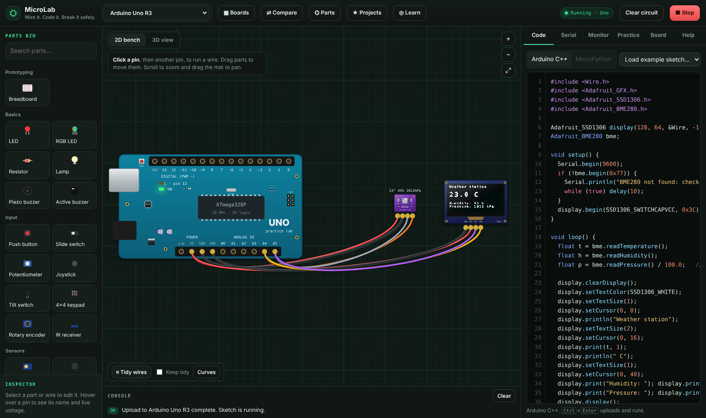
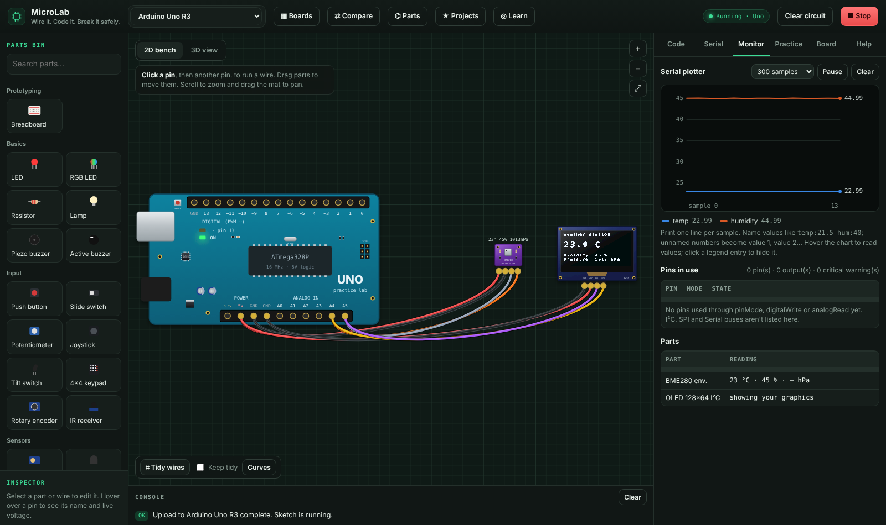
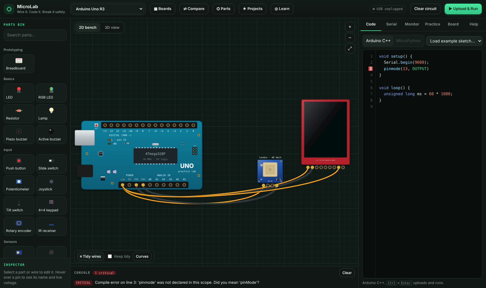
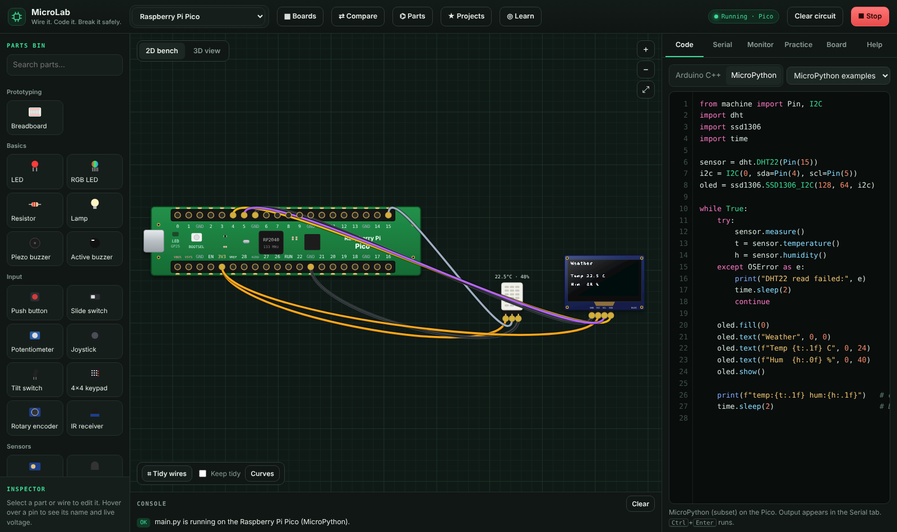
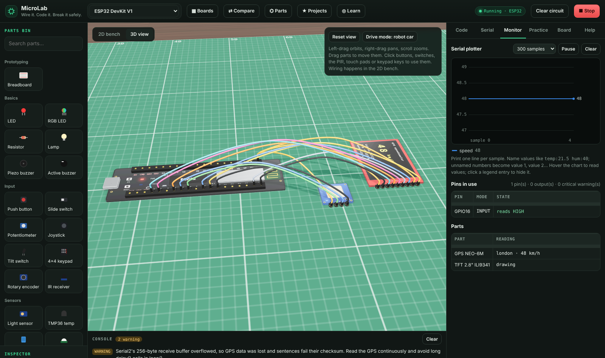
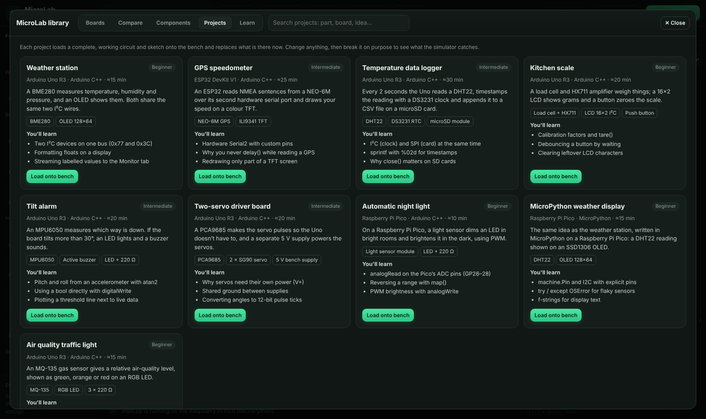
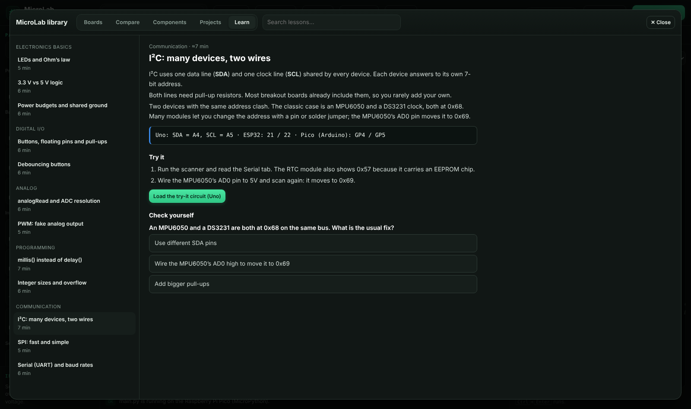

# MicroLab

**A microcontroller lab in your browser. Wire it. Code it. Break it safely.**

Place a board, wire up sensors, displays and motors, write real Arduino C++ or MicroPython, and run it. MicroLab follows each board's real electrical limits and language rules, then tells you exactly what would go wrong on real hardware, before you burn out an LED or a GPIO pin.

**Try it:** https://frediljosue.github.io/MicroLab/ · no install, no account, runs entirely in your browser.

[](https://github.com/frediljosue/MicroLab/actions/workflows/tests.yml)



## What you can do

| | |
|---|---|
| **Build circuits** | 23 placeable boards (Arduino, ESP32/ESP8266, Raspberry Pi Pico, STM32, Teensy) and 57 parts: LEDs, buttons, pots, servos, steppers, relays, LCD/OLED/TFT displays, GPS, SD cards, IMUs, load cells, gas and weather sensors… Breadboard, 2D bench and a 3D view. |
| **Write real code** | Arduino C++ compiled with the board's real rules, or MicroPython on Pico and ESP boards. Real libraries: Servo, Wire, SD, DHT, Adafruit GFX/SSD1306/ILI9341/BME280/MPU6050/NeoPixel/PWMServoDriver, RTClib, TinyGPSPlus, HX711, Keypad, LiquidCrystal_I2C and more. |
| **See what's happening** | Serial monitor, a live **serial plotter**, and a dashboard of every pin's state and every part's reading. |
| **Get caught (kindly)** | Too much current on a pin, 5 V into a 3.3 V board, swapped SDA/SCL, I²C address clashes, a servo powered from USB, a missing pull-up, a GPS buffer overflowing because of `delay()`… each comes with a plain-language fix. |
| **Learn** | 12 short lessons with try-it circuits and check questions, 17 practice challenges with automatic checking, and 9 complete projects to load and modify. |
| **Look things up** | Specs, clickable pinouts and side-by-side comparison for 25 boards; datasheet-style info sheets for 77 components. |

<table>
<tr><td></td><td></td></tr>
<tr><td align="center">Serial plotter + live dashboard</td><td align="center">Errors point at the line and suggest the fix</td></tr>
<tr><td></td><td></td></tr>
<tr><td align="center">MicroPython on a Pico</td><td align="center">3D view</td></tr>
<tr><td></td><td></td></tr>
<tr><td align="center">Projects</td><td align="center">Lessons with try-it circuits</td></tr>
</table>

## How real is it?

MicroLab is honest about what it simulates. Every board and part is labelled with one of three levels:

| Level | Meaning |
|---|---|
| **Simulated** | Your code really runs, and libraries behave like the real ones: return values, buffers, addresses, timing rules. Voltages, currents and pin limits come from datasheets. Simplified: exact timing, analog noise, heat, and anything below logic level (rise times, ESD). |
| **Reference only** | Specs, pinout, wiring and common mistakes, but it can't be placed or run (micro:bit, Particle Photon, and some parts). |
| **Not executable** | Wi-Fi and Bluetooth traffic, real USB, PIO, deep sleep, interrupts at true hardware speed and bootloaders. MicroLab says so instead of faking it. |

The language rules are real too:

- **Arduino C++** follows the selected board: `int` is 16-bit on AVR boards (so `60 * 1000` overflows on an Uno, exactly as on hardware) and 32-bit elsewhere; integer division truncates; `char`, arrays, `struct`/`class`, references, `static` locals, `sizeof`, `String` and `sprintf` behave as on the real board. Not supported yet: templates, inheritance, dynamic memory (`new`).
- **MicroPython** uses MicroPython's rules: arbitrary-size ints, single-precision floats, `/` vs `//`, and real tracebacks. Modules: `machine` (Pin, ADC, PWM, I2C, Timer, time_pulse_us), `time`, `math`, `random`, `dht`, `neopixel`, `ssd1306`. Not supported yet: generators, `with`, inheritance, files, UART/SPI.

More detail: [docs/simulation-model.md](docs/simulation-model.md).

## Getting started

1. Open the [live lab](https://frediljosue.github.io/MicroLab/), or download `index.html` and open it in Chrome, Edge or Firefox. It's a single file and works offline (the 3D view needs internet once to load three.js).
2. Press **★ Projects** and load **Weather station**.
3. Press **▶ Upload & Run**, then open the **Monitor** tab to watch the readings.
4. Now break something: drag the BME280's SDA wire to another pin and run again.

New to microcontrollers? Start with **◎ Learn → LEDs and Ohm's law**. Full walkthrough: [docs/getting-started.md](docs/getting-started.md).

## Repository layout

```
index.html            the whole app: one self-contained page (HTML + CSS + JS)
docs/                 guides and reference
  getting-started.md  first steps for students
  simulation-model.md what is and isn't simulated, and how accurately
  languages.md        the C++ compiler and MicroPython runtime
  contributing-parts.md how to add a board, part, project or lesson
tests/                140 browser tests (pytest + Playwright), run in CI on every push
```

## Running the tests

```bash
cd tests
npm install                     # local copy of three.js, so tests run offline
pip install -r requirements.txt
python -m playwright install chromium
python -m pytest -q
```

The suite covers C++ semantics and compile errors, every board, every simulated part's library example, every challenge solution except the hand-driven 3D robot car (with simulated button presses and sensor changes), every project and lesson, MicroPython, and data consistency (every part has an icon, info sheet and 3D model).

## Contributing

Corrections to specs are especially welcome. If a number in a board or part sheet is wrong, open an issue with a datasheet link. See [CONTRIBUTING.md](CONTRIBUTING.md).

## License

MIT © 2026 Fredil Martinez. Board and part names are trademarks of their owners; MicroLab is an independent educational tool and isn't affiliated with Arduino, Espressif, Raspberry Pi, STMicroelectronics, PJRC or any part maker.
